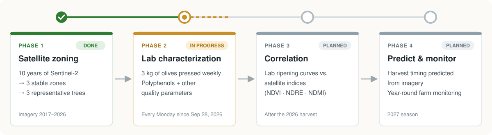
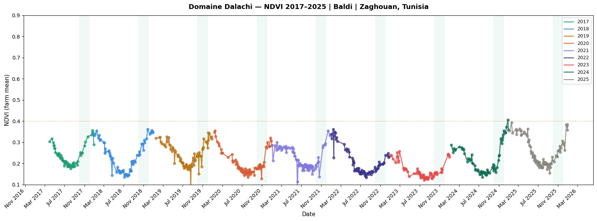
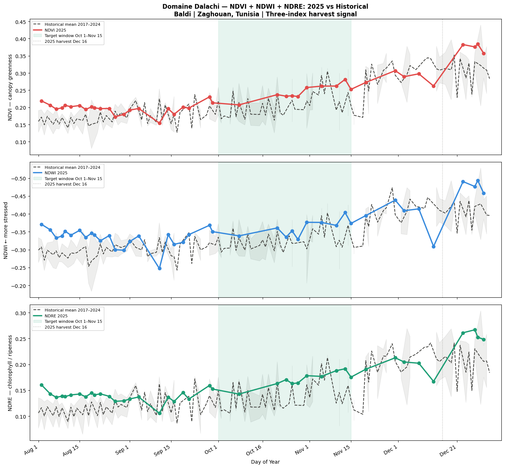
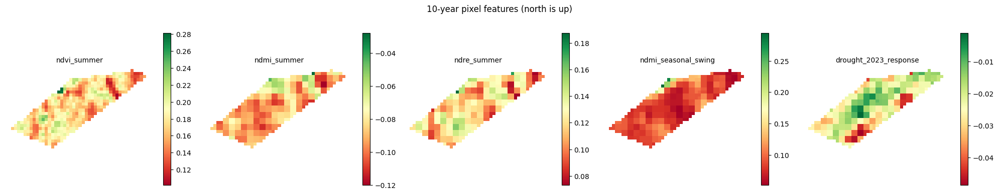
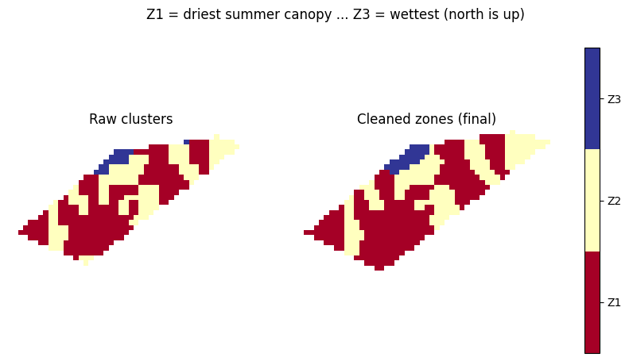
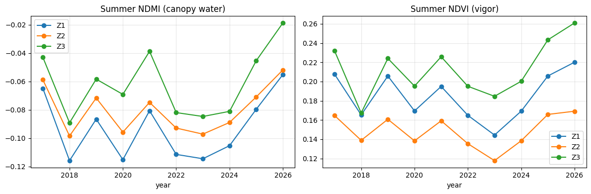
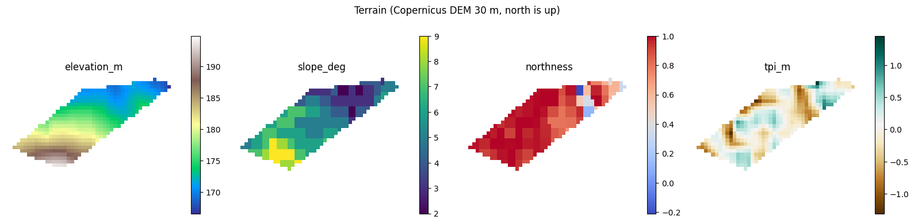

# Baldi Research

**Characterizing an unstudied Tunisian olive variety with satellite imagery and lab chemistry.**

Baldi is a small monovarietal olive grown on my family's farm, Domaine Dalachi, in the Zaghouan region of Tunisia. It has never been characterized in the scientific literature. This project combines 10 years of Sentinel-2 satellite data with weekly lab analysis of the oil to (1) characterize the variety for the first time and (2) learn to read its ripening from space, so harvest can be timed to the oil's quality peak.

> **Status (Oct 2026):** Phase 1 (satellite zoning and tree selection) is complete. Phase 2 (weekly lab sampling) has been running since Sep 28, 2026. Phases 3–4 are planned.

---

## Why this matters

The polyphenol concentration of olive oil follows a bell curve during ripening: it rises, peaks, then declines. Polyphenols drive the oil's bitterness, pungency, shelf life and health value, so harvesting at the peak matters. For a well-studied variety, the timing of that peak is known; for Baldi, nobody knows it yet.

The 2025 harvest showed the cost of guessing: the olives were picked on Dec 16, 2025, and the oil measured 155 mg/kg of polyphenols when tested in March 2026 (after storage in plastic, which lowers the value). That is modest for a premium extra-virgin oil, and an earlier harvest is the most likely lever.

Measuring the curve in a lab every season is slow and expensive. If the curve can be linked to signals visible in satellite imagery, the farm can be monitored all year and harvest timing predicted remotely.

## Project roadmap



| Phase | What | Status |
|---|---|---|
| 1 | Divide the farm into management zones from satellite data and choose representative sampling trees | ✅ Done — [notebook](Pipelines/Zoning_Pipeline.ipynb), [report (PDF)](docs/Zoning-Report.pdf) |
| 2 | Every Monday from Sep 28, 2026, a partner olive-biochemistry lab in Tunisia presses 3 kg of olives from the selected trees and measures total polyphenols and other quality parameters, to locate the polyphenol peak | 🟡 In progress |
| 3 | Correlate the lab time series with Sentinel-2 indices over the same weeks | ⬜ Planned (after the harvest season) |
| 4 | Predict harvest timing from imagery for the 2027 season; build a year-round monitoring system for the farm | ⬜ Planned |

---

## Exploration — the farm's satellite history

[`Sentinel_2_DataAnalysis.ipynb`](Pipelines/Sentinel_2_DataAnalysis.ipynb) was the first pass: every Sentinel-2 image with under 20% cloud cover from 2017 to 2025 (about 670 dates), reduced to farm-mean NDVI, NDWI and NDRE.



Three things came out of it:

- **A strong yearly cycle.** Farm-mean NDVI falls through the dry summer and rises after the autumn rains. The farm is rainfed and has about 100 trees/ha, so each 10 m pixel is part olive canopy, part ground; much of this cycle is ground cover greening and drying, not the trees.
- **A repeatable autumn turning point.** The yearly NDWI minimum in Oct–Nov fell between Oct 25 and Nov 15 in all 9 years (mean Nov 9). In 2025 it came on Nov 13, 33 days before the actual harvest.
- **Visible differences inside the farm.** Pixel-level Oct–Nov NDWI ranged from −0.48 to −0.24, which motivated a proper zoning analysis below.



What these autumn signals mean for the olives (ripening, water stress, polyphenols) is **an open hypothesis**. Because canopy and ground are mixed, the lab series in Phase 2 is what will confirm or rule it out. This is also why Phase 1 moved to summer composites, when the evergreen canopy dominates the signal, and to NDMI for canopy water.

---

## Phase 1 — Satellite zoning

**Question:** the lab can only analyze a few trees. Which trees represent the farm, and does the farm have distinct parts that behave differently?

**The study area:** 5.83 ha of the farm (which is a little over 6 ha in total), about 100 trees/ha (~580 trees), rainfed (no irrigation), on a north-facing mountain slope between 167 and 195 m altitude.

### Method

1. **Data.** Every Sentinel-2 Level-2A image over the farm from 2017 to 2026 (about 70 images per summer), cloud-masked pixel by pixel with Google's Cloud Score+, processed in Google Earth Engine.
2. **Seasonal composites.** For each year, a summer median (Jul–Sep, when the evergreen olive canopy dominates the signal) and a winter median (Dec–Feb).
3. **Indices.** NDVI (vegetation vigor), NDRE (chlorophyll), NDMI (canopy water content).
4. **Per-pixel features.** The 10 m edge strip was removed (mixed with the road and neighbouring land), leaving **472 pixels of 10 × 10 m**. Each pixel is described by five features summarising its 10-year behaviour: median summer NDVI, NDRE and NDMI; the winter-to-summer NDMI swing; and its response to the 2023 drought.
5. **Clustering.** Features standardized, then K-means (20 restarts) for K = 2, 3, 4, scored with the silhouette coefficient.
6. **Cleaning.** Majority filter, merging of fragments under 8 pixels (0.08 ha, too small to manage separately), and edge fill so zones cover the whole farm.
7. **Validation.** Year-by-year stability of the zone ranking, and comparison with terrain from the Copernicus 30 m DEM (elevation, slope, aspect, topographic position).



### Choosing the number of zones

| K | Silhouette | Pixels per zone | Reading |
|---|---|---|---|
| 2 | 0.282 | 215 / 257 | 19 unusual pixels are forced into a main zone |
| **3** | **0.311** | **273 / 180 / 19** | **Best: the unusual pixels get their own zone, the rest splits cleanly in two** |
| 4 | 0.275 | 19 / 148 / 153 / 152 | Same 19 pixels; an extra split adds no clarity |

All scores are moderate: the farm changes gradually rather than having sharp borders. The same 19-pixel group appears at both K = 3 and K = 4, which shows it is a genuine feature of the data rather than an artefact.

### Result: three zones



| Zone | Area | Summer NDVI | Summer NDRE | Summer NDMI | Seasonal NDMI swing | Interpretation |
|---|---|---|---|---|---|---|
| Z1 | 3.45 ha | 0.185 | 0.128 | −0.096 | 0.092 | Main grove: more canopy and chlorophyll |
| Z2 | 2.12 ha | 0.150 | 0.101 | −0.082 | 0.074 | Thinner canopy; strips running down the slope across the terraces |
| Z3 | 0.26 ha | 0.213 | 0.138 | −0.063 | 0.189 | Small patch with twice the seasonal swing; behaves like annual vegetation or a water-collecting spot. Excluded from sampling, kept under observation |

### The zones are stable



The zone ranking held in **every one of the 10 years** for both NDMI and NDVI. Weather moves the whole farm up and down together (dry years 2018, 2020, 2022–2024), but the gaps between zones stay roughly constant, so the zones reflect permanent properties of the farm. Because year-to-year swings are larger than the differences between zones, monitoring should compare each zone with its own history rather than with other zones.

### Terrain



The farm drops about 30 m from the forest in the south-west to the road in the north-east and faces north throughout, which suits rainfed olives (less direct sun, slower soil drying). Terrain explains part of the pattern, but only part: the strongest relationship is between the seasonal swing and topographic position (r = −0.40; hollows swing more), and Z3 sits in the lowest hollow of the farm (171 m, TPI −0.51).

### Tree selection

Three trees were chosen to cover the farm's main water situations, each placed well inside its zone (15–20 m from zone borders, 30 m from the road and from Z3, 20 m from the farm edge, 40 m from the forest corner):

| Tree | Role | Zone | Altitude | Landform |
|---|---|---|---|---|
| TREE_01 | Receives runoff | Z1 | 172 m | Clear hollow (TPI −1.06) |
| TREE_02 | Intermediate | Z1 | 185 m | Neutral slope (TPI +0.02) |
| TREE_03 | Sheds water | Z2 | 171 m | Clearest bump (TPI +0.54) |

The full write-up, with the reasoning behind each step, is in the [zoning report](docs/Zoning-Report.pdf).

---

## Repository structure

```
Pipelines/Sentinel_2_DataAnalysis.ipynb   Exploration: farm-mean time series 2017–2025, with outputs
Pipelines/Zoning_Pipeline.ipynb   Phase 1 pipeline (Earth Engine + scikit-learn), with outputs
docs/Zoning-Report.pdf            Phase 1 report
figures/                          Figures used in this README (exported from the notebook)
requirements.txt
```

## Running the pipeline

The notebook was developed on Google Colab and needs a [Google Earth Engine](https://earthengine.google.com/) account.

1. Open `Pipelines/Zoning_Pipeline.ipynb` in Colab (or Jupyter with `pip install -r requirements.txt`).
2. Set `PROJECT_ID` in the settings cell to your Earth Engine Cloud project.
3. Create `Pipelines/farm_boundary.json` with your field boundary as a closed list of `[longitude, latitude]` pairs. The farm's own boundary is kept private and is not in the repo.
4. Run all cells. Outputs: zone polygons (`dalachi_zones.geojson`) and a per-pixel table (`dalachi_zoning_pixels.csv`).

**Stack:** Python, Google Earth Engine, Sentinel-2 L2A, Cloud Score+, Copernicus DEM, pandas, NumPy, SciPy, scikit-learn, Shapely, pyproj, Matplotlib.

## Limitations

- **Resolution.** At 10 m, one pixel covers roughly one tree plus the soil around it (about 100 trees/ha), so indices mix canopy and ground. This is why NDVI values are low (0.15–0.21).
- **Soft zone borders.** Silhouette scores of 0.28–0.31 indicate real but gradual differences.
- **Terrain resolution.** The DEM is 30 m against 10 m imagery, so small terraces and micro-relief are smoothed out.
- **Not yet in the notebook.** The runoff analysis used for the final tree choice is described in the report but not yet part of the pipeline.
- **Deprecated dataset.** `COPERNICUS/DEM/GLO30` should be migrated to `GLO30_2024_1`.

## Next steps

- Finish the 2026 weekly lab series and publish the ripening curves for Baldi.
- Build a weekly Sentinel-2 time series for the three trees' pixels over the sampling period and test correlations with the lab results.
- Add weather data (rainfall, temperature) to separate the water-year effect from ripening.
- Turn the notebook into a scheduled monitoring job for the farm.

## Author

**Jaafar Ben Khaled**, San José State University · [LinkedIn](https://www.linkedin.com/in/jaafarbenkhaled/). Lab characterization in collaboration with an olive biochemistry research lab in Tunisia.

## License

Code: MIT (see [LICENSE](LICENSE)). The report and figures are © Jaafar Ben Khaled, all rights reserved.
